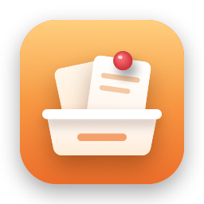
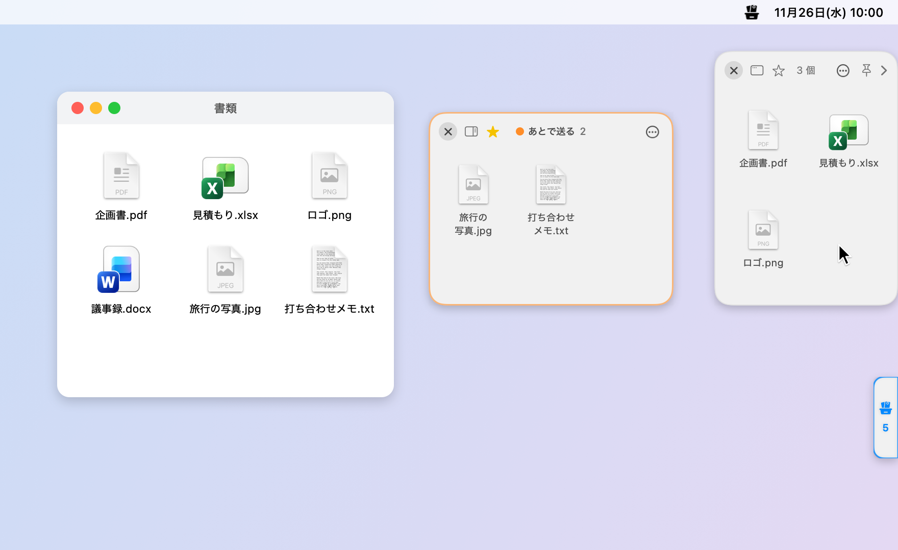
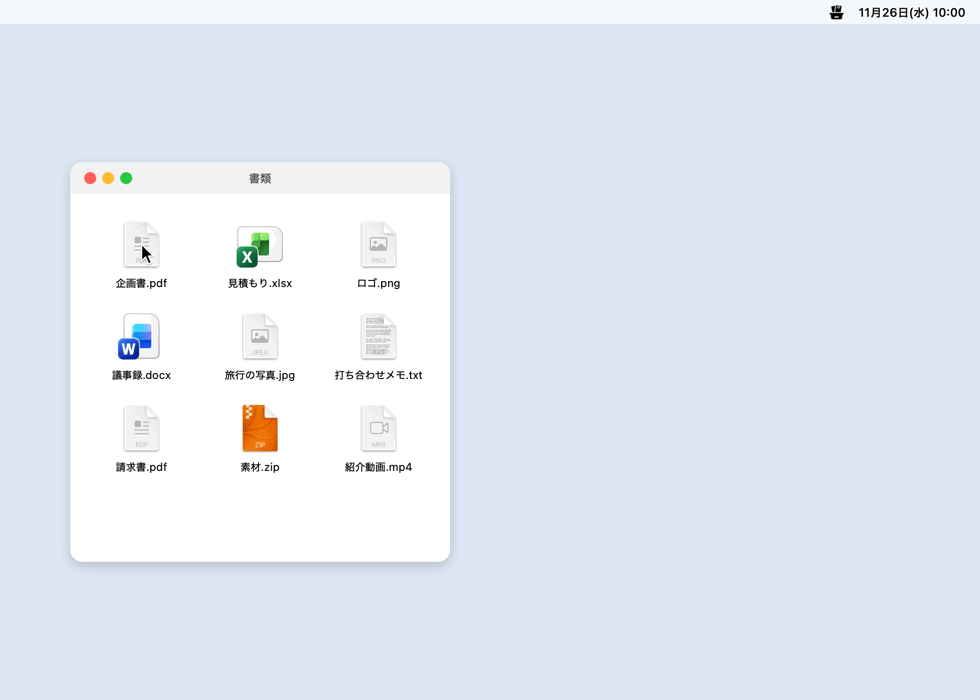
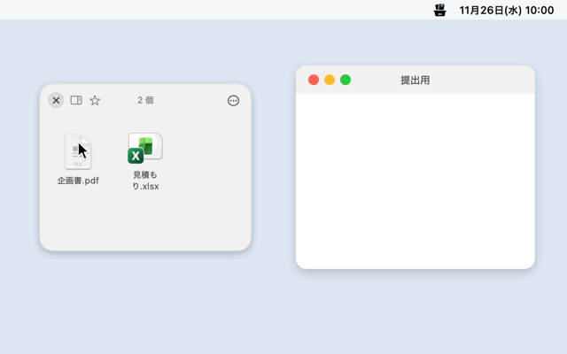
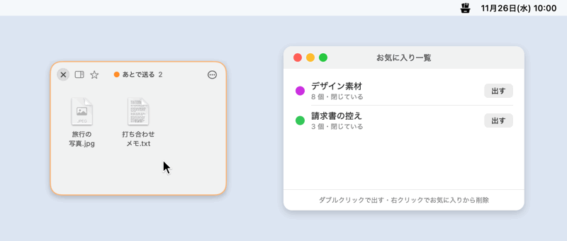

<p align="center">
  
</p>

<h1 align="center">Pinshelf</h1>

<p align="center">
  ドラッグ中のファイルを、画面の端や手元の「棚」に一時的に置いておける macOS のメニューバーアプリ
</p>

<p align="center">
  <a href="LICENSE"></a>
  
  
</p>

<p align="center">
  
</p>

> [!NOTE]
> **いまは β 版です。** 思わぬ不具合があるかもしれません。見つけたら [Issues](https://github.com/nexy-apps/pinshelf/issues) で教えてください。操作や設定の保存形式は、正式版までに変わることがあります。

> **English:** Pinshelf is a macOS menu bar app that gives you a temporary "shelf" for the files you are dragging. Start a drag and a shelf slides out from the edge of the screen, or shake the cursor to open one right where you are. Drop files, text, or links on it, then drag them out wherever you need them. The UI is currently in Japanese.

## 使い方

1. **置く**：ファイルをドラッグし始めると、画面の端に細い帯が出ます。帯の近くまで運ぶと棚が開くので、そのまま落とします。離れると、棚は帯にたたみます

   <p align="center">
     
   </p>

2. **その場に出す**：ドラッグ中にマウスを軽く振るか ⇧ を押すと、カーソルの位置に棚が出ます。浮いた棚は、画面の端まで運ぶと帯にしまえます

   <p align="center">
     
   </p>

3. **取り出す**：棚からほかのアプリへドラッグします。Finder と同じく、同じディスクなら移動、⌥ を押しながらならコピーです。⌘L でロックしたものは、取り出しても棚に残ります

   <p align="center">
     
   </p>

4. **とっておく**：見出しの ☆ を押すと ★ になり、お気に入りの棚になります。閉じても中身ごと残り、メニューバーの「お気に入りの棚」や「お気に入り一覧…」から出し直せます

   <p align="center">
     
   </p>

## できること

- **画面の端に出す**：ファイルをドラッグし始めると、画面の端に細い帯が出ます。帯の近くまで運ぶと棚が開き、そのまま落とせます。左右どちらの端に出すか・出す高さ（カーソルの高さについてくることもできます）・出すときを選べます
- **振って出す・キーで出す**：ドラッグ中にマウスを軽く振るか、決めたキー（初期設定は ⇧）を押すと、カーソルの位置に棚が出ます
- **画面の端にしまう**：浮いた棚を画面の端まで運ぶと、細い帯にたたんでしまえます。帯の近くに来ると開き、離れるとたたみます。見出しのピンで、棚ごとに開いたままにもできます
- **取り出す**：棚からほかのアプリへドラッグで取り出せます（Finder と同じく、同じディスクなら移動、⌥ でコピー）。棚から棚へも移せます
- **中身の扱い**：Quick Look（スペースキー）・ロック（取り出しても残す）・スタック（一緒に置いたものをまとめる）・元に戻す（⌘Z）
- **棚の名前・色・お気に入り**：お気に入りの棚は閉じても中身ごと残り、メニューバーや「お気に入り一覧」から出し直せます。閉じた棚は「最近閉じた棚」から開き直せます
- **大きさ**：棚の縁をつかんで大きさを変えられます。画面の端にあるとき・浮いているときの標準の大きさも決められます
- **メニューバー・クリップボードから入れる**：メニューバーのアイコンに落とすか、ショートカット（初期設定は ⌥⇧V）で、コピー中のものを棚に入れられます
- **再起動しても残す**：棚の中身・位置・大きさを残し、再起動しても元に戻します。ログイン時に起動もできます
- **アップデート**：新しい版を 1 時間に 1 回確かめ、メニューバーのアイコンの印とメニューで知らせます（画面には割り込みません）。メニューから、そのまま更新できます
- アクセシビリティなどの許可は要りません。フルスクリーンのアプリの上や、別のデスクトップでも使えます

くわしい操作は [docs/USAGE.md](docs/USAGE.md) を見てください。

## ダウンロード

[Releases](https://github.com/nexy-apps/pinshelf/releases) から `Pinshelf-<版>.dmg` をダウンロードして開き、`Pinshelf` を `Applications`（アプリケーションフォルダ）へドラッグしてください（`.zip` もあります。展開して `Pinshelf.app` を入れる形で、中身は同じです）。macOS 26 以降で、Intel と Apple Silicon のどちらの Mac でも動きます。

**本物の Pinshelf は、この [Releases](https://github.com/nexy-apps/pinshelf/releases) からだけ配っています。** ほかの場所で配られているものは、作者が作ったものではありません。

作者が自分で作った証明書（nexy Release Signing）で署名していますが、Apple の公証は受けていないので、初めて開くときに「開発元を確認できない」と止められます。次のどちらかで開けます。

- 一度開こうとしたあと、システム設定 →「プライバシーとセキュリティ」の下の方にある「このまま開く」を押す
- ターミナルで `xattr -dr com.apple.quarantine /Applications/Pinshelf.app` を実行してから開く

開くと、メニューバーに Pinshelf のアイコンが出ます（Dock には出ません）。ファイルをドラッグし始めると、画面の端に棚が出ます。出し方は、メニューバーのアイコン →「設定…」で変えられます。

入れたあとは、アプリの中から新しい版に更新できます（メニューバーのアイコン →「アップデートを確認…」。自動でも確かめます）。更新のときは、「このまま開く」は要りません。

2026-11 に、アプリの ID と署名を変えて、版を 0.1.0 から出し直しました。それより前の β 版（ID `app.pinshelf.Pinshelf`）からは更新できないので、使っていた場合は、ここから入れ直してください（前の版の棚と設定は引き継がれません）。

## ソースからビルド

自分でビルドする場合の手順です。自分の Mac でビルドしたアプリは、「開発元を確認できない」という警告が出ません。

### 用意するもの

- macOS 26 以降
- Xcode 26 以降（App Store から入れる。コマンドラインツールだけではビルドできません）
- [XcodeGen](https://github.com/yonaskolb/XcodeGen)

### 手順

```bash
brew install xcodegen
git clone https://github.com/nexy-apps/pinshelf.git
cd pinshelf
make install
```

`make install` は配る版と同じ作り（最適化など）でビルドし、開発のビルドとして `/Applications/Pinshelf Dev.app` に入れます（ID は `app.nexy.Pinshelf.dev`、画面の名前は「Pinshelf Dev」。配る版の Pinshelf とは別のアプリとして並びます。更新の機能は出ません）。Intel と Apple Silicon のどちらの Mac でも動きます。

最初に 1 回だけ、署名に使う証明書を作ります（`make cert`。途中で Mac のログインパスワードを聞かれます。初めてビルドするときに、codesign が鍵を使ってよいかを聞かれたら「常に許可」を押します）。証明書がないと、`make install` などは止まって案内を出します。証明書を作らずにビルドしたいときは `ADHOC=1` を付けます（アドホック署名。ビルドのたびに、許可を取り直すことになります）。

```bash
make cert
make install
```

初めてビルドするときに、更新の仕組み（[Sparkle](https://sparkle-project.org)）の配布物を GitHub から取り寄せて、`Vendor/Sparkle` に置きます（ネットワークが要ります。取り寄せたファイルは、決めてある SHA-256 と合うことを確かめてから使います）。

### 新しい版にする

```bash
cd pinshelf
git pull
make install
```

`make install` は、動いている Pinshelf Dev を終了してから入れ替えます。棚の中身と設定はそのまま残ります。

### 削除

```bash
make uninstall
```

設定と棚の中身は残ります。すべて消すときは、`~/Library/Containers/app.nexy.Pinshelf.dev`（自分でビルドしたもの）・`~/Library/Containers/app.nexy.Pinshelf`（Releases から入れたもの）も削除してください。

## 開発するとき

| コマンド | 内容 |
|---|---|
| `make cert` | 開発用の証明書（`nexy Dev Signing`）を作る（最初に一度だけ。作者以外は `DEV_CERT="〇〇 Dev Signing"` で自分の名前にできる） |
| `make setup` | push の前に自動テストを流す git hooks を有効にする（最初に一度だけ） |
| `make run` | 動いている Pinshelf Dev を終了し、開発用（Debug）にビルドして起動する |
| `make build` | 開発用にビルドするだけ |
| `make test` | テストを動かす（アプリは起動しない） |
| `make install` | 配る版と同じ設定でビルドし、`/Applications/Pinshelf Dev.app` に入れる |
| `make uninstall` | `/Applications/Pinshelf Dev.app` を削除する（設定と棚の中身は残る） |
| `make dist` | Releases に置く DMG と zip（`dist/Pinshelf-<版>.dmg`・`.zip`・`.sha256`）を作る（作者だけ。金庫を開けて、配る版用の証明書で署名する。パスワードを聞かれる） |
| `make publish` | DMG と zip を作り、GitHub に Release（タグ `v<版>`）を作ってアップロードする（作者だけ）。β 版は `make publish BETA=1`（タグ `v<版>-beta.1`・プレリリース）。zip に金庫の中の鍵で署名し、版の一覧（`appcast.xml`）を作って、置き場所（[nexy-apps.github.io](https://github.com/nexy-apps/nexy-apps.github.io)）に送るまで行う（コミット済みで、GitHub の main と同じ状態からだけ動く） |
| `make update-test` | 更新を、手元で通しで試す（別の ID の試験用アプリを 2 つの版で作り、手元のサーバーから配る。[docs/TESTING.md](docs/TESTING.md)） |
| `make update-test-log` | 更新の試験のあいだの macOS の記録を、`build/update-test/system.log` に書き出す（うまくいかないときの手がかり） |
| `make stop` | 動いている Pinshelf Dev を終了する（棚を保存してから終わるのを待つ。配る版の Pinshelf は止めない） |
| `make generate` | `Pinshelf.xcodeproj` を作るだけ（Xcode で開くとき） |
| `make icon` | アプリのアイコンを描き直す（`scripts/make-app-icon.swift` を変えたとき） |
| `make readme-images` | README の見本の画像（`docs/images/`）を作り直す（棚の見た目を変えたとき。作っている間、画面に棚やウィンドウが少し出る） |

`Pinshelf.xcodeproj` は `project.yml` から作るため、リポジトリには入れていません。Xcode で開いて ⌘R で動かすこともできます（`make generate` のあと `open Pinshelf.xcodeproj`）。

### 署名について

macOS は、アプリが同じものかを「アプリの ID ＋ 署名の証明書」で見分けます。証明書なし（アドホック署名）では、ビルドし直すたびに別のアプリと見なされます。そこで、開発のビルド（`make run`・`make install`・`make update-test`）は、`make cert` で作る自分の証明書で署名します（[scripts/create-signing-cert.sh](scripts/create-signing-cert.sh)）。証明書がなければ止まって案内を出し、`ADHOC=1` を付けたときだけアドホック署名にします。

配る版は、作者だけが持つ別の証明書（`nexy Release Signing`）で署名します。この証明書と、更新ファイルの署名の鍵は、ふだんは閉まっている鍵付きのキーチェーン（金庫）に入っていて、`make dist`・`make publish` のときだけ、作者がパスワードで開けます（[scripts/vault.sh](scripts/vault.sh)）。くわしくは [docs/ARCHITECTURE.md](docs/ARCHITECTURE.md) の「署名」を見てください。

## 必要な許可とプライバシー

- アクセシビリティ・入力監視・画面収録などの許可は求めません。ほかのアプリで始まったドラッグは、マウスのボタンの押し・離しと、ドラッグ用のクリップボードの変化で見つけます。キーボードの入力は監視しません
- ネットワークに接続するのは、新しい版の確認と、その更新のダウンロードのときだけです。接続先は GitHub（版の一覧 `https://nexy-apps.github.io/pinshelf/appcast.xml` と、Releases の更新ファイル）で、棚の中身・使い方・Mac の情報は送りません（GitHub には、接続元の IP アドレスと、アプリの名前と版が伝わります）。自動の確認は、設定の「一般」→「新しい版を自動で確かめる」で止められます
- 更新ファイルは、作者の鍵（EdDSA）の署名を確かめてから入れます。合わないものは入れません
- 棚はファイルをコピーせず、場所（security-scoped bookmark）を覚えるだけです。元のファイルが動くのは、棚からドラッグで取り出したとき（Finder と同じく、同じディスクなら移動）だけです
- 棚の中身（ファイルの場所・テキスト・リンク）・位置・名前・色・最近閉じた棚は、`~/Library/Containers/app.nexy.Pinshelf/Data/Library/Application Support/Pinshelf/shelves.json` に保存します（自分でビルドした Pinshelf Dev は `app.nexy.Pinshelf.dev` の中）
- クリップボードから入れた画像は、PNG にして同じフォルダの `Clipboard` に置きます。どの棚にも（最近閉じた棚・⌘Z で戻せる分にも）使わなくなった画像は、すぐに完全に削除します（入れたばかりの画像は、棚に置くまでの 1 分だけ残します）
- 使い続けても容量が増え続けないよう、Pinshelf が自分で作るファイルは、どれも決まった基準で消します。最近閉じた棚は 10 個まで、Quick Look でテキストを見るための一時ファイルは使わなくなったときと起動・終了のとき、読めなかった保存ファイルの控えは 3 つまでです。棚に置いた元のファイルは、Pinshelf が消すことはありません
- クリップボードの中身を読むのは、「クリップボードから棚へ」を使ったときと、棚で ⌘V・「貼り付ける」を選んだときだけです（メニューを開いたときは、中身があるかだけを確かめます）
- App Sandbox を有効にしています。Pinshelf が開けるのは、棚に入れたファイル（ドラッグ・コピーで渡したもの）と、上の保存場所だけです
- 「ログイン時に起動」は、設定でオンにしたときだけ登録します

## コードについて

- コードの構成と設計のメモ：[docs/ARCHITECTURE.md](docs/ARCHITECTURE.md)
- テスト：`make test`（シェイクの判定・棚の位置・棚の中身・保存の形式・設定・大きさなど、画面に関係ない処理）。画面の操作は [docs/TESTING.md](docs/TESTING.md) の一覧で手で確かめます

不具合の報告や提案は [Issues](https://github.com/nexy-apps/pinshelf/issues) へどうぞ。

## ライセンス

[PolyForm Shield License 1.0.0](LICENSE)

Pinshelf のソースコードは公開していますが、オープンソースのライセンスではありません。使う・改変する・配ることはできますが、Pinshelf と競合する製品（または、作者が Pinshelf を使って提供する製品と競合する製品）を提供するために使うことはできません。正確な条件は、[ライセンスの本文](LICENSE)（英語）を見てください。

アップデートの仕組みには、[Sparkle](https://sparkle-project.org)（MIT ライセンスなど）を使っています。ライセンスの全文は [Pinshelf/Licenses/Sparkle.txt](Pinshelf/Licenses/Sparkle.txt) にあり、アプリにも同梱しています。
